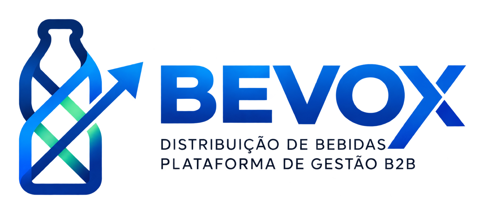

<p align="center">
  
</p>

# BEVOX

**Plataforma B2B SaaS para gestão de conformidade, auditoria preventiva e controle de alvarás e licenças em Centros de Distribuição de Bebidas (CDDs).**

---

## Sumário

1. [Resumo](#1-resumo)
2. [Contextualização e problema](#2-contextualização-e-problema)
3. [Objetivos](#3-objetivos)
4. [Escopo funcional](#4-escopo-funcional)
5. [Requisitos não funcionais](#5-requisitos-não-funcionais)
6. [Arquitetura e tecnologias](#6-arquitetura-e-tecnologias)
7. [Organização do código](#7-organização-do-código)
8. [Instalação e execução](#8-instalação-e-execução)
9. [Equipe](#9-equipe)
10. [Contexto acadêmico](#10-contexto-acadêmico)

---

## 1. Resumo

O BEVOX é uma aplicação web que centraliza o acompanhamento de documentos regulatórios de Centros de Distribuição de Bebidas, permitindo visualizar prazos de vencimento, classificar documentos por nível de risco e antecipar renovações. O projeto adota uma abordagem de governança legal preventiva, substituindo o controle manual em planilhas por uma interface única, filtrável por unidade operacional.

## 2. Contextualização e problema

Os CDDs operam sob regulamentação rigorosa e precisam manter diversas licenças ativas simultaneamente, entre elas:

- Alvará de Funcionamento
- Licença Ambiental (CPRH)
- AVCB do Corpo de Bombeiros
- Laudo SPDA
- Licença da Vigilância Sanitária

A gestão desses documentos em planilhas manuais favorece a perda de prazos, o que pode resultar em:

| Consequência | Impacto |
|---|---|
| Interdição e lacre dos galpões | Paralisação da operação |
| Multas e autos de infração aplicados pelos órgãos reguladores | Custo financeiro não previsto |
| Interrupção da distribuição aos Pontos de Venda (PDVs) | Perda de receita e de clientes |
| Falta de previsibilidade de custos e prazos de renovação | Desorganização operacional |

## 3. Objetivos

### Objetivo geral

Desenvolver uma plataforma web que consolide a situação regulatória de múltiplos CDDs e apoie a tomada de decisão preventiva sobre vencimentos de licenças e alvarás.

### Objetivos específicos

- Classificar os documentos em três níveis de risco: **Crítico**, **Atenção** e **Conforme**, de acordo com o prazo restante para o vencimento.
- Permitir a visualização individual por unidade (CDD Recife, CDD Jaboatão e CDD Caruaru) e a visão consolidada.
- Oferecer busca e filtros que agilizem a consulta de documentos.
- Apresentar alertas preventivos sobre prazos críticos.
- Projetar a evolução dos vencimentos ao longo do tempo por meio de visualizações gráficas.
- Estruturar o código de modo que os dados simulados possam ser substituídos por uma API real sem alterar a camada de interface.

## 4. Escopo funcional

### Módulo 1: Autenticação e acesso

| Código | Requisito |
|---|---|
| RF01 | Autenticação de usuário por e-mail e senha. |
| RF02 | Cadastro de usuário com nome, e-mail, senha e vínculo a uma unidade base. |
| RF03 | Gestão de sessão do usuário ativo e opção de encerrar a sessão. |

### Módulo 2: Painel principal

| Código | Requisito |
|---|---|
| RF04 | Indicadores de resumo com o total de documentos e a divisão por nível de risco (Conformes, Atenção e Críticos). |
| RF05 | Gráfico de projeção temporal de vencimentos e renovações. |
| RF06 | Painel de alertas preventivos, baseado na data limite da licença e no tempo médio de tramitação no órgão emissor. |
| RF07 | Panorama de risco por unidade operacional. |

### Módulo 3: Documentos e unidades

| Código | Requisito |
|---|---|
| RF08 | Seletor de unidade, alternando entre um CDD específico e a visão consolidada. |
| RF09 | Busca por nome do documento e filtro por status (Todos, Críticos, Atenção e Conformes). |
| RF10 | Consulta de data de vencimento, órgão emissor e status, com ações de visualização e download de documentos. |
| RF11 | Gestão multiunidade, com contadores de pendências por CDD. |

### Critério de classificação de risco

| Status | Prazo para o vencimento |
|---|---|
| Crítico | até 30 dias |
| Atenção | de 31 a 90 dias |
| Conforme | acima de 90 dias |

## 5. Requisitos não funcionais

| Código | Requisito |
|---|---|
| RNF01 | Interface construída com Tailwind CSS, seguindo um design system de paleta executiva e layout responsivo. |
| RNF02 | Aplicação em Next.js (App Router), sem dependência de infraestrutura externa na fase de front-end. |
| RNF03 | Boa densidade de informação, com estados visuais de interação (hover e foco) e acessibilidade básica por teclado. |
| RNF04 | Dados tipados em TypeScript, em formato compatível com o JSON esperado de futuras rotas de API. |

## 6. Arquitetura e tecnologias

| Camada | Tecnologia | Justificativa |
|---|---|---|
| Framework | Next.js 16 (App Router) | Interface e rotas de API no mesmo projeto. |
| Interface | React 19 | Componentização e renderização reativa. |
| Linguagem | TypeScript 5 | Tipagem estática dos contratos de dados. |
| Estilização | Tailwind CSS v4 | Tokens de design consistentes, configurados em `src/app/globals.css`. |
| Ícones | Lucide React | Iconografia leve e uniforme. |
| Visualização de dados | Recharts | Gráficos vetoriais temporais e responsivos. |
| Qualidade de código | ESLint 9 | Padronização e análise estática. |
| Persistência (front-end) | `localStorage` e dados simulados em TypeScript | Independência de infraestrutura nas demonstrações. |
| Persistência (prevista) | Prisma ORM + SQLite | Estrutura declarativa para o banco de dados e rotas internas em `/api`. |

## 7. Organização do código

```bash
.
├── public/                     # Arquivos estáticos
├── src/
│   ├── app/                    # Rotas, layout raiz e estilos globais
│   │   ├── login/
│   │   ├── globals.css
│   │   ├── layout.tsx
│   │   └── page.tsx
│   ├── components/
│   │   ├── dashboard/          # Componentes do painel (ex.: TabelaDocs)
│   │   ├── layout/             # Componentes estruturais (ex.: Header)
│   │   └── login/              # Componentes de autenticação
│   ├── data/                   # Dados simulados
│   └── types/                  # Tipagens compartilhadas
├── package.json
└── README.md
```

## 8. Instalação e execução

**Pré-requisito:** [Node.js](https://nodejs.org/) instalado.

```bash
git clone https://github.com/AllanVCordeiroS/Residencia-Tecnologica02.git
cd Residencia-Tecnologica02
npm install
npm run dev
```

A aplicação fica disponível em [http://localhost:3000](http://localhost:3000).

Outros scripts disponíveis:

| Comando | Descrição |
|---|---|
| `npm run build` | Gera a versão de produção. |
| `npm run start` | Executa a versão de produção. |
| `npm run lint` | Executa a análise estática com ESLint. |

## 9. Equipe

Integrantes em ordem alfabética:

- Allan Vinícius
- Arthur Santiago
- Breno Matheus
- Bruno Falcão
- Emanuelly Lapa
- Matheus Felipe
- Thays Fernanda

## 10. Contexto acadêmico

Projeto desenvolvido no âmbito da **Residência Tecnológica (Porto Digital / Embarque Digital)**, que tem como empresa parceira a **Motiron Technologies**.
